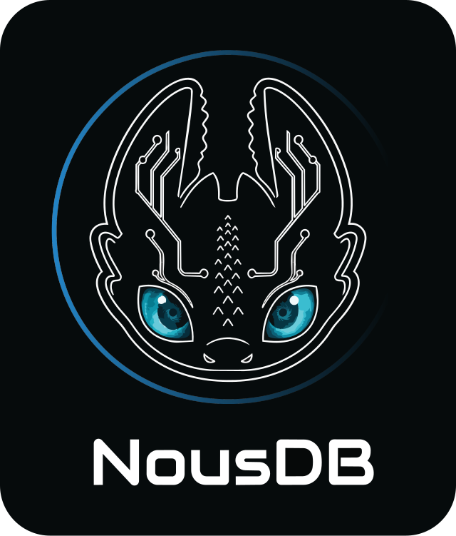

<p align="center">
  
</p>

<p align="center">
  <a href="https://crates.io/crates/nousdb"></a>
  <a href="https://docs.rs/nousdb"></a>
  <a href="https://github.com/Ctsap/nousdb/actions/workflows/ci.yml"></a>
  <a href="https://www.apache.org/licenses/LICENSE-2.0"></a>
</p>

# NousDB

NousDB is a semantic query engine built on [Apache DataFusion]. It adds
operators whose logic is a natural-language instruction answered by a large
language model: add a column the model fills in, keep the rows the model
accepts, join the rows the model says belong together, or generate a table
from a description. These operators compose with ordinary SQL and DataFrame
operations in one plan, and NousDB's optimizer decides how many rows go into
each model request and how to spread the work over partitions.

```rust,no_run
use nousdb::prelude::*;
use std::sync::Arc;

#[tokio::main]
async fn main() -> nousdb::datafusion::error::Result<()> {
    let registry = Arc::new(ModelRegistry::new());
    registry.register(OllamaProvider::builder().build().await?)?;
    let ctx = NousDBContext::new(registry)?;

    ctx.register_csv("reviews", "reviews.csv", CsvReadOptions::new()).await?;
    ctx.nousdb_table("reviews")
        .await?
        .extend(
            ("sentiment", DataType::Utf8),
            "llama3.1:latest",
            "Classify the sentiment of the review as positive, negative or neutral.",
            ["review"],
        )?
        .filter(col("sentiment").eq(lit("positive")))?
        .show()
        .await?;
    Ok(())
}
```

[Apache DataFusion]: https://datafusion.apache.org

## Contents

- [NousDB](#nousdb)
  - [Contents](#contents)
  - [Installation](#installation)
    - [Cargo features](#cargo-features)
  - [Quickstart](#quickstart)
  - [Core concepts](#core-concepts)
  - [Models and providers](#models-and-providers)
    - [Ollama](#ollama)
    - [OpenAI-compatible endpoints](#openai-compatible-endpoints)
    - [The built-in catalog](#the-built-in-catalog)
    - [Adding your own model](#adding-your-own-model)
    - [Several providers](#several-providers)
    - [Concurrency](#concurrency)
  - [Writing NousDB programs](#writing-nousdb-programs)
    - [Extend: add model-derived columns](#extend-add-model-derived-columns)
    - [Semantic selection: keep the rows the model accepts](#semantic-selection-keep-the-rows-the-model-accepts)
    - [Semantic join: pair the rows the model matches](#semantic-join-pair-the-rows-the-model-matches)
    - [Generate: a table from a description](#generate-a-table-from-a-description)
    - [Mixing with SQL and relational operators](#mixing-with-sql-and-relational-operators)
    - [Writing good instructions](#writing-good-instructions)
  - [SQL](#sql)
  - [The optimizer](#the-optimizer)
    - [Token histograms](#token-histograms)
    - [Inspecting plans](#inspecting-plans)
  - [Quality certification](#quality-certification)
  - [Reasoning modes](#reasoning-modes)
  - [Configuration reference](#configuration-reference)
    - [`NousDBContextBuilder`](#nousdbcontextbuilder)
    - [Environment variables](#environment-variables)
  - [Writing a custom provider](#writing-a-custom-provider)
  - [Python](#python)
  - [Limitations](#limitations)
  - [Citation](#citation)
  - [License](#license)

## Installation

```toml
[dependencies]
nousdb = "0.1"
tokio = { version = "1", features = ["macros", "rt-multi-thread"] }
```

NousDB's API uses DataFusion and Arrow types, so each NousDB release is built
on one DataFusion major version:

| NousDB | DataFusion | Arrow | Minimum Rust |
|---|---|---|---|
| 0.1 | 55.2 | 59 | 1.94 |

Use the re-exported `nousdb::datafusion` (or depend on the same DataFusion
version) so the types match. A new DataFusion major version is a breaking
NousDB release.

### Cargo features

| Feature | Default | Enables |
|---|---|---|
| `openai` | yes | `OpenAiCompatibleProvider` for OpenAI-compatible HTTP endpoints |
| `ollama` | yes | `OllamaProvider` for Ollama's native API |

With `default-features = false` you can still implement your own
[`ModelProvider`](#writing-a-custom-provider).

## Quickstart

1. Start a model server. The quickest is [Ollama](https://ollama.com):

   ```sh
   ollama pull llama3.1
   ollama serve
   ```

   Any server that speaks the OpenAI chat completions API and supports
   structured output (JSON schema) works too: [vLLM], SGLang, a LiteLLM
   proxy, OpenAI or Azure OpenAI.

2. Run the example above, or one of the examples in this repository:

   ```sh
   cargo run -p nousdb --example quickstart
   ```

   The examples talk to local Ollama by default. Point them elsewhere with
   `NOUSDB_BASE_URL` (an OpenAI-compatible `/v1` URL), `NOUSDB_MODEL` and,
   if the endpoint needs one, `NOUSDB_API_KEY`.

| Example | Shows |
|---|---|
| `quickstart` | `extend` followed by a relational filter |
| `semantic_select` | filtering rows with a natural-language predicate |
| `semantic_join` | joining two tables on a natural-language condition |
| `generate` | creating a table from a description, then enriching it |
| `custom_model_card` | serving a model the built-in catalog does not know |
| `quality_certification` | certified batch sizing and `EXPLAIN ANALYZE` |

[vLLM]: https://docs.vllm.ai

## Core concepts

**`NousDBContext`** is the session. It wraps DataFusion's `SessionContext` and
dereferences to it, so everything DataFusion offers (`register_csv`,
`register_parquet`, `sql`, `table`, UDFs, object stores) works unchanged. On
top of that it installs NousDB's planner and optimizer rules.

**`NousDBDataFrame`** is a DataFusion `DataFrame` with the semantic operators
added. Get one from `ctx.nousdb_table(name)`, `ctx.nousdb_sql(query)`,
`ctx.to_nousdb(df)` or `ctx.generate(...)`. Relational methods such as
`filter`, `select`, `sort`, `join` and `aggregate` return a `NousDBDataFrame`
too, so a chain can mix both kinds freely.

**Plans are lazy.** Building a frame never calls a model. Models run when the
plan executes: `collect`, `show`, `count`, or `explain` with `analyze = true`.

**`ModelRegistry`** holds the providers a session may use. Operators name
their model by id (for example `"llama3.1:latest"` or `"Qwen/Qwen3-8B"`), and
the planner asks the registry which provider serves it.

**`ModelCard`** describes one model: its context window, its output limit and
how many rows NousDB may pack into a request. The planner sizes requests from
the card, so a model can only be used once a provider has a card for it.

**Packed requests.** NousDB never sends one request per row. It renders a
batch of rows into a single prompt and asks for a JSON array with one answer
per row, constrained by a JSON schema. The batch size comes from the
optimizer, bounded by the card.

## Models and providers

### Ollama

`OllamaProvider` lists the models installed on the server and creates a card
for each:

```rust,no_run
# async fn example() -> nousdb::datafusion::error::Result<()> {
use nousdb::prelude::*;

let ollama = OllamaProvider::builder()
    .url("http://localhost:11434")
    .max_concurrent(4) // match OLLAMA_NUM_PARALLEL
    .build()
    .await?;
# Ok(()) }
```

Derived cards use the model's trained context length, capped at 8,192 tokens,
and every request asks Ollama for exactly that context (`num_ctx`). Add a card
with `.model(...)` to use a larger window.

### OpenAI-compatible endpoints

`OpenAiCompatibleProvider` covers vLLM, SGLang, LiteLLM, OpenAI and Ollama's
`/v1` endpoint:

```rust,no_run
# async fn example() -> nousdb::datafusion::error::Result<()> {
use nousdb::prelude::*;
use std::time::Duration;

let vllm = OpenAiCompatibleProvider::builder("vllm")
    .base_url("http://localhost:8000/v1")
    .timeout(Duration::from_secs(120))
    .max_concurrent(64)
    .build()
    .await?;

let openai = OpenAiCompatibleProvider::builder("openai")
    .base_url("https://api.openai.com/v1")
    .api_key_env("OPENAI_API_KEY")
    .build()
    .await?;
# Ok(()) }
```

### The built-in catalog

`OpenAiCompatibleProvider` starts from `ModelCatalog::builtin()`, which
describes a few common models (GPT-4o mini, Qwen3 8B and 30B-A3B, Llama 3.1 8B
and Llama 3.3 70B). Print it with:

```rust,no_run
for card in nousdb::ModelCatalog::builtin().cards() {
    println!("{}: {} tokens", card.id, card.context_window);
}
```

### Adding your own model

Any model the endpoint serves can be used once it has a card. In code:

```rust,no_run
# async fn example() -> nousdb::datafusion::error::Result<()> {
use nousdb::prelude::*;

let card = ModelCard::new("mistralai/Mistral-Small-3.2-24B-Instruct-2506", 32_768)
    .with_name("Mistral Small 3.2")
    .with_max_output_tokens(4_096)
    .with_quality_max_batch_size(16)
    .with_max_concurrent_requests(8)
    .with_pricing(0.0001, 0.0003);

let provider = OpenAiCompatibleProvider::builder("vllm")
    .base_url("http://localhost:8000/v1")
    .model(card)
    .build()
    .await?;
# Ok(()) }
```

Or keep the cards in a TOML file and load it with `ModelCatalog::from_file`:

```toml
[[models]]
id = "mistralai/Mistral-Small-3.2-24B-Instruct-2506"
name = "Mistral Small 3.2"
context_window = 32768
max_output_tokens = 4096
quality_max_batch_size = 16
max_concurrent_requests = 8
pricing = { input_per_1k_tokens = 0.0001, output_per_1k_tokens = 0.0003 }
```

```rust,no_run
# async fn example() -> nousdb::datafusion::error::Result<()> {
use nousdb::prelude::*;

let catalog = ModelCatalog::builtin().merge(ModelCatalog::from_file("models.toml")?);
let provider = OpenAiCompatibleProvider::builder("vllm")
    .base_url("http://localhost:8000/v1")
    .catalog(catalog)
    .build()
    .await?;
# Ok(()) }
```

A card with the same id as an existing one replaces it.

| Card field | Meaning |
|---|---|
| `id` | Model name sent to the endpoint; queries refer to the model by it |
| `name` | Display name (defaults to the id) |
| `context_window` | Context length in tokens, prompt and answer together |
| `max_output_tokens` | Output budget sent with each request; when unset, 20% of the context is reserved for the answer |
| `max_batch_size` | Most rows (row pairs, for a join) per request; default 10 |
| `quality_max_batch_size` | Tighter cap above which the model's answers get worse; optional |
| `max_concurrent_requests` | Requests each partition keeps in flight; default 1 |
| `pricing` | Price per 1,000 input and output tokens, for `ModelCard::estimate_cost` |

`max_output_tokens` matters: answers are constrained to a JSON array, and an
answer that runs out of tokens is an unterminated array, so the whole batch is
lost. Set it to what your deployment allows.

### Several providers

Register as many providers as you like. An operator's model resolves to the
first registered provider that has a card for it. To pick one explicitly,
prefix the model with the provider's name: `"vllm/Qwen/Qwen3-8B"`. A full model
id always wins over that form.

```rust,no_run
# async fn example() -> nousdb::datafusion::error::Result<()> {
use nousdb::prelude::*;
use std::sync::Arc;

let registry = Arc::new(ModelRegistry::new());
registry.register(OllamaProvider::builder().build().await?)?;
registry.register(
    OpenAiCompatibleProvider::builder("vllm")
        .base_url("http://gpu-box:8000/v1")
        .build()
        .await?,
)?;
for (provider, card) in registry.models() {
    println!("{provider}: {}", card.id);
}
# Ok(()) }
```

### Concurrency

Two settings bound how many requests are in flight:

- `max_concurrent` on the provider caps requests to the endpoint across
  every query and partition.
- A card's `max_concurrent_requests` (or the provider's `request_window`,
  which sets it on every card) is how many requests each partition keeps in
  flight.

The effective concurrency is `min(partitions × window, max_concurrent)`.
Continuous-batching servers such as vLLM do best with a window of 8 to 16;
rate-limited cloud APIs with a window of 1. Set the number of partitions with
DataFusion's `SessionConfig::with_target_partitions`.

## Writing NousDB programs

A NousDB program registers its data, builds a frame from a table or a SQL
query, applies semantic and relational operators, and executes it.

### Extend: add model-derived columns

```rust,no_run
# async fn example(ctx: nousdb::NousDBContext) -> nousdb::datafusion::error::Result<()> {
use nousdb::prelude::*;

let movies = ctx
    .nousdb_sql("SELECT title, review FROM movies WHERE year >= 2000")
    .await?
    .extend(
        vec![
            ("sentiment", DataType::Utf8),
            ("mentions_actor", DataType::Boolean),
            ("rating", DataType::Int64),
        ],
        "llama3.1:latest",
        "Read the review. Give its sentiment (positive, negative or neutral), \
         whether it names an actor, and the rating from 1 to 10 it implies.",
        ["title", "review"],
    )?;
# Ok(()) }
```

- **Arguments:** the new columns, the model, the instruction, and the input
  columns the model sees.
- **Output:** the input columns followed by the new ones.
- **Types:** `Utf8`, `Int64`, `Float64` and `Boolean`. New columns are
  nullable, and the model may answer `null` when it cannot tell.
- **Failures:** if a request fails or its answer cannot be decoded, its rows
  get `NULL` in the new columns and the query continues.

### Semantic selection: keep the rows the model accepts

```rust,no_run
# async fn example(ctx: nousdb::NousDBContext) -> nousdb::datafusion::error::Result<()> {
let about_plot = ctx
    .nousdb_table("reviews")
    .await?
    .semantic_select(
        "llama3.1:latest",
        "The review discusses the plot or the storyline.",
        ["review"],
    )?;
# Ok(()) }
```

- **Output:** the input columns, for the rows the model judged true.
- **Failures:** rows of a failed request are kept, so a failure never
  silently drops data.

### Semantic join: pair the rows the model matches

```rust,no_run
# async fn example(ctx: nousdb::NousDBContext) -> nousdb::datafusion::error::Result<()> {
let people = ctx.nousdb_table("people").await?;
let reviews = ctx.nousdb_table("reviews").await?;

let mentions = people.semantic_join(
    reviews,
    ["name"],   // left columns the model sees
    ["review"], // right columns the model sees
    "llama3.1:latest",
    "The review mentions this person.",
)?;
# Ok(()) }
```

- **Output:** all left columns followed by all right columns, for every pair
  the model accepts. Join columns may be qualified (`"p.name"`).
- **Cost:** the model sees every left and right pair, packed many to a
  request, so the cost grows with the product of the two sizes. Filter both
  sides first.
- **Failures:** a failed request contributes no matches.

### Generate: a table from a description

```rust,no_run
# async fn example(ctx: nousdb::NousDBContext) -> nousdb::datafusion::error::Result<()> {
use nousdb::prelude::*;

let startups = ctx
    .generate(
        vec![("name", DataType::Utf8), ("founded", DataType::Int64)],
        "llama3.1:latest",
        "Fictional early-stage technology startups.",
        20,
    )?
    .extend(
        ("sector", DataType::Utf8),
        "llama3.1:latest",
        "The sector this startup most likely works in.",
        ["name"],
    )?;
# Ok(()) }
```

`generate_with_examples` also takes a few `RecordBatch`es of example rows to
show the model the style and range you want. Generation runs again each time
the plan executes, and it may return fewer rows than asked if some requests
fail.

### Mixing with SQL and relational operators

Semantic operators are methods on `NousDBDataFrame`; SQL supplies the input.
Everything DataFusion's `DataFrame` offers composes with them:

```rust,no_run
# async fn example(ctx: nousdb::NousDBContext) -> nousdb::datafusion::error::Result<()> {
use nousdb::datafusion::functions_aggregate::expr_fn::count;
use nousdb::prelude::*;

let df = ctx
    .nousdb_sql("SELECT id, title, review FROM movies")
    .await?
    .semantic_select("llama3.1:latest", "The review is about a comedy.", ["review"])?
    .extend(("tone", DataType::Utf8), "llama3.1:latest", "One word for its tone.", ["review"])?
    .aggregate(vec![col("tone")], vec![count(col("id")).alias("n")])?
    .sort(vec![col("n").sort(false, false)])?;

let batches = df.collect().await?;
# Ok(()) }
```

To use a plain DataFusion `DataFrame`, convert it with `ctx.to_nousdb(df)`.

### Writing good instructions

- State the decision and the allowed answers ("positive, negative or
  neutral").
- Name the input columns in the instruction when there are several.
- Keep the instruction the same across queries: NousDB places it before the
  row data, so endpoints with prefix caching (vLLM) reuse it.

## SQL

The semantic operators are also SQL functions, registered in every
`NousDBContext`. Names resolve in any case, and the arguments are always the
instruction, the model, then the rest. They build the same plans as the
DataFrame methods, so the optimizer treats both alike.

```sql
-- EXTEND in a SELECT list: one new column (Utf8, or the type you name)
SELECT *, EXTEND('classify sentiment', 'llama3.1:latest', review) AS sentiment FROM reviews;
SELECT *, EXTEND('rate 1 to 5', 'llama3.1:latest', review, 'Int64') AS stars FROM reviews;
SELECT *, EXTEND('rate 1 to 5', 'llama3.1:latest', review, 'stars: Int64') FROM reviews;

-- EXTEND in FROM: several columns at once, over a table or a subquery
SELECT * FROM EXTEND(reviews, 'extract both', 'llama3.1:latest', review,
                     'sentiment: Utf8, genre: Utf8');

-- SEM_FILTER: an AND-ed condition in WHERE
SELECT * FROM papers
WHERE SEM_FILTER('is about databases', 'llama3.1:latest', abstract) AND year > 2020;

-- SEM_JOIN: in an INNER JOIN's ON, or in WHERE over a comma join
SELECT * FROM a JOIN b ON SEM_JOIN('same product?', 'llama3.1:latest', a.title, b.name);

-- GENERATE: a table from a description, optionally with examples
-- (JSON objects, one per line)
SELECT * FROM GENERATE('20 fictional startups', 'llama3.1:latest',
                       'name: Utf8, pitch: Utf8', 20);
```

Run them with `ctx.sql(..)` (the stock DataFusion entry point) or
`ctx.nousdb_sql(..)`, which returns a `NousDBDataFrame` you can keep chaining:

```rust,no_run
# async fn example(ctx: nousdb::NousDBContext) -> nousdb::datafusion::error::Result<()> {
let batches = ctx
    .sql(
        "SELECT * FROM (SELECT *, EXTEND('classify sentiment', 'llama3.1:latest', review) AS sentiment \
                        FROM reviews) \
         WHERE sentiment = 'positive'",
    )
    .await?
    .collect()
    .await?;

let df = ctx
    .nousdb_sql("SELECT * FROM reviews WHERE SEM_FILTER('mentions the plot', 'llama3.1:latest', review)")
    .await?;
# Ok(()) }
```

Things to know:

- `SEM_FILTER` must be a whole condition AND-ed with the others (not under
  `OR`); `SEM_JOIN` works in inner joins only; `EXTEND` goes in a SELECT list
  or in `FROM`, not in `WHERE`, `GROUP BY` or `ORDER BY`. Use a subquery to
  filter on a derived column.
- Instructions, models, types and row counts are string and number literals;
  inputs are plain column names.
- The optimizer's rewrites find the operators in a nested query, but a table
  alias between two of them (`(SELECT ...) AS t`) stops them.
- `NousDBContextBuilder::with_sql_functions(false)` leaves the functions out
  and makes this a plain DataFusion session.
- Next to `SEM_JOIN`, a relational condition reading one side filters that
  side before the join; one reading both sides directly (`a.k = b.k`) is an
  error; a volatile, column-free, correlated or two-sided-subquery condition
  is applied after the join. In `WHERE` over `FROM a, b, c`, `SEM_JOIN` must
  compare `c` with the rest (relations are not reordered).
- A correlated condition in a subquery with `SEM_FILTER` is applied after the
  semantic selection; the other relational conditions before it.
- `EXTEND` in a SELECT list runs on every input row, even inside a `CASE`
  branch that would not be evaluated. A plain `LIMIT` above it is pushed
  below it by DataFusion (the extend allows limit pushdown), so the model
  sees the limited rows only; `ORDER BY ... LIMIT` and a `WHERE` above it are
  not, so sort or filter the input in a subquery.
- A `LIMIT` above `SEM_FILTER` stops the filter after that many accepted
  rows, and a `LIMIT` above `GENERATE` asks the model for those rows only
  (the first rows of the same table). A `LIMIT` above `SEM_JOIN` still
  evaluates every pair.
- `SEM_FILTER` over a join runs once per joined row; filter the base table in
  a subquery to pay once per base row.

## The optimizer

NousDB adds logical rules after DataFusion's own:

1. **Semantic rewrites** push selections below extends and joins, run cheap
   selections first, put the larger join input on the left, and fuse an
   extend with the selection or join that consumes it.
2. **Histogram injection** (optional) attaches token-length histograms of the
   input columns.
3. **Token repartitioning** spreads rows over partitions so each partition
   carries a similar number of tokens.
4. **Batch sizing** picks each operator's rows per request so a request fits
   the context window with high probability, bounded by the card.

Configure them with `SemanticOptimizerConfig`:

```rust,no_run
# fn example(registry: std::sync::Arc<nousdb::ModelRegistry>) -> nousdb::datafusion::error::Result<()> {
use nousdb::prelude::*;

let ctx = NousDBContextBuilder::new(registry)
    .with_config(SessionConfig::new().with_target_partitions(8))
    .with_semantic_optimizer(SemanticOptimizerConfig {
        rewrites: true,
        token_repartition: TokenRepartitionChoice::Auto,
        batch_sizing: BatchSizingChoice::Fixed {
            batch_size: 16,
            join_blocks: None,
        },
    })
    .build()?;
# Ok(()) }
```

### Token histograms

Batch sizing and repartitioning work best with token histograms of your text
columns. Build them once from CSV files and point the session at them:

```rust,no_run
# fn example(registry: std::sync::Arc<nousdb::ModelRegistry>) -> nousdb::datafusion::error::Result<()> {
use nousdb::core::token_estimator::prepare_csv_folder;
use nousdb::prelude::*;
use std::path::Path;

prepare_csv_folder(Path::new("data/"), Path::new("histograms/"))?;
let ctx = NousDBContextBuilder::new(registry)
    .with_histogram_catalog("histograms/")
    .build()?;
# Ok(()) }
```

Histograms are keyed by table and column name (`histograms/<table>/<column>.json`).
Without them NousDB estimates the batch size from the card alone.

### Inspecting plans

`explain` shows the chosen batch sizes and request windows; with
`analyze = true` it runs the query and reports tokens, requests, failures and
time per operator:

```rust,no_run
# async fn example(df: nousdb::NousDBDataFrame) -> nousdb::datafusion::error::Result<()> {
df.explain(false, true).await?.show().await?;
# Ok(()) }
```

## Quality certification

Packing many rows into one request saves time and money, but can change the
answers. Quality certification measures that. Before an operator runs at
scale, it compares packed answers with one-row-at-a-time answers on a sample,
and picks the largest batch size whose agreement is at least `1 - eta` with
confidence `1 - delta`. Certificates are cached for the session.

```rust,no_run
# fn example(registry: std::sync::Arc<nousdb::ModelRegistry>) -> nousdb::datafusion::error::Result<()> {
use nousdb::prelude::*;

let ctx = NousDBContextBuilder::new(registry)
    .with_quality_certification(QualityCertConfig {
        eta: 0.10,
        delta: 0.05,
        tolerated_disagreements: Some(5),
        ..QualityCertConfig::default()
    })
    .build()?;
# Ok(()) }
```

- It applies to extend, selection and join.
- The sample costs model calls, so it pays off on large inputs. Use
  `min_rows_for_certification` to skip small ones and `max_probes` to bound
  the cost.
- `tolerated_disagreements` lets a batch size survive a few disagreements;
  without it, the first disagreement rules a size out.
- It turns token repartitioning off.

## Reasoning modes

`ReasoningMode` changes how operators ask the model to answer:

| Mode | Effect |
|---|---|
| `Off` (default) | Answer directly |
| `Scaffold` | Prompt asks the model to judge each row on its own |
| `Rationale` | Model writes a short rationale before each answer (not returned) |
| `Think` | Like `Scaffold`, for models with a thinking phase |

```rust,no_run
# async fn example(registry: std::sync::Arc<nousdb::ModelRegistry>) -> nousdb::datafusion::error::Result<()> {
use nousdb::prelude::*;

let ctx = NousDBContextBuilder::new(registry)
    .with_reasoning_mode(ReasoningMode::Rationale)
    .build()?;
# Ok(()) }
```

For `Think`, also enable thinking on the provider with
`OpenAiCompatibleProvider::builder(..).thinking(true)`; the server must apply
the JSON schema to the answer only (in vLLM, run it with a
`--reasoning-parser`).

## Configuration reference

### `NousDBContextBuilder`

| Method | Purpose |
|---|---|
| `with_config(SessionConfig)` | DataFusion settings: partitions, batch size, … |
| `with_runtime_env(Arc<RuntimeEnv>)` | Memory limit and spill directory |
| `with_semantic_optimizer(SemanticOptimizerConfig)` | Configure NousDB's rules |
| `with_optimizer_rules(rules)` | Replace every logical rule, DataFusion's included |
| `with_histogram_catalog(dir)` | Load token histograms |
| `with_quality_certification(QualityCertConfig)` | Certified batch sizing |
| `with_reasoning_mode(ReasoningMode)` | How operators ask for answers |
| `with_sql_functions(bool)` | The [SQL functions](#sql) (default on) |

### Environment variables

Builder settings take precedence over these.

| Variable | Effect |
|---|---|
| `NOUSDB_MAX_CONCURRENT_REQUESTS` | Default `max_concurrent` of `OpenAiCompatibleProvider` (128) |
| `NOUSDB_ENABLE_THINKING` | `1`/`true` turns thinking on for `OpenAiCompatibleProvider` |
| `NOUSDB_REASONING_MODE` | `off`, `scaffold`, `rationale` or `think` |
| `NOUSDB_TRACE_DIR` | Writes every request (prompt, answer, tokens) as JSON lines to this directory |
| `NOUSDB_TRACE_TAG` | Name used in trace file names (default `run`) |
| `RUST_LOG` | Log level for `env_logger` and similar; `info` shows optimizer decisions |

## Writing a custom provider

Implement `ModelProvider` to reach any other model service. A provider lists
the models it serves and answers one packed request at a time. The helpers in
`nousdb::core::providers::utils` build the JSON schema and decode the answer:

```rust,no_run
use async_trait::async_trait;
use nousdb::core::providers::utils::{clean_model_response, parse_json_to_model_outputs};
use nousdb::core::providers::{InferenceMetrics, PredictResult};
use nousdb::core::{BatchRenderer, Prompt};
use nousdb::datafusion::arrow::record_batch::RecordBatch;
use nousdb::datafusion::error::Result;
use nousdb::{ModelCard, ModelProvider};

#[derive(Debug)]
struct MyService;

impl MyService {
    async fn complete(&self, system: Option<String>, user: String, schema: String) -> String {
        unimplemented!("send the prompt, constrained by `schema`, to your service")
    }
}

#[async_trait]
impl ModelProvider for MyService {
    fn name(&self) -> &str {
        "my-service"
    }

    fn models(&self) -> Vec<ModelCard> {
        vec![ModelCard::new("my-model", 32_768).with_max_output_tokens(4_096)]
    }

    async fn predict(
        &self,
        _model_id: &str,
        prompt: &Prompt,
        batch: &RecordBatch,
        start_row: usize,
        batch_size: usize,
        renderer: &(dyn BatchRenderer + Send + Sync),
    ) -> Result<PredictResult> {
        let system = prompt.render_system()?;
        let user = prompt.render_batch(renderer, batch, start_row, batch_size)?;
        let schema = self.construct_output_schema(prompt, batch_size);
        let answer = self.complete(system, user, schema).await;
        let parsed = parse_json_to_model_outputs(&clean_model_response(&answer), prompt, batch_size);
        Ok(PredictResult::new(
            parsed.outputs,
            InferenceMetrics::zero(),
            parsed.row_count_mismatch,
        ))
    }
}
```

Return `Err` only for problems that should stop the query. A request that
fails in transport should return `PredictResult::transport_failure`, so the
operator can recover (keep the rows, fill `NULL`, and so on).

## Python

Python bindings, which extend the `datafusion` Python package, are developed
separately.

## Limitations

- Semantic operators are available through the DataFrame API and the [SQL
  functions](#sql), with the limits listed there.
- Semantic group-by and aggregation are work in progress.
- Token counts use the `cl100k_base` tokenizer for every model, so batch sizes
  are estimates for models with other tokenizers.
- Text and tabular data are the only supported modalities.

## Citation

If you use NousDB in your research, please cite the
[paper](https://arxiv.org/abs/2610.28551):

```bibtex
@misc{tsapelas2026nousdbfastquery,
      title={NousDB - A Fast Query Engine for Semantic Analytics},
      author={Christos Tsapelas and Georgia Koutrika and Yannis Ioannidis},
      year={2026},
      eprint={2610.28551},
      archivePrefix={arXiv},
      primaryClass={cs.DB},
      url={https://arxiv.org/abs/2610.28551},
}
```

## License

Licensed under the [Apache License, Version 2.0](https://www.apache.org/licenses/LICENSE-2.0).
